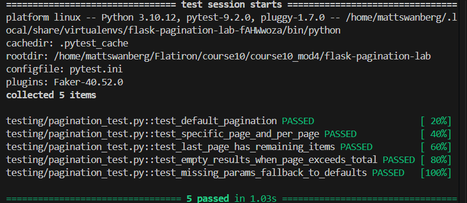

# Lab: Flask Pagination

## Overview

This project implements server-side pagination for a Flask RESTful API using Flask-SQLAlchemy and Marshmallow.

The application provides a `/books` endpoint that retrieves book records from a SQLite database. Instead of returning every record in a single response, the endpoint allows clients to request a specific page and number of books per page.

Pagination improves API efficiency by limiting the number of records retrieved and returned in each request.

## Technologies Used

- Python 3
- Flask
- Flask-RESTful
- Flask-SQLAlchemy
- Flask-Migrate
- Marshmallow
- SQLite
- Pipenv
- Pytest

## Features

- Server-side pagination using SQLAlchemy's `.paginate()` method.
- Configurable `page` and `per_page` query parameters.
- Default pagination values when parameters are omitted.
- Structured JSON responses containing pagination metadata.
- Serialization of book records using Marshmallow.
- Graceful handling of requests beyond the available pages.
- Automated testing using Pytest.

## Project Structure

Key project files and directories:

```text
flask-pagination-lab/
├── Pipfile
├── Pipfile.lock
├── README.md
├── screenshots/
└── server/
    ├── app.py
    ├── config.py
    ├── models.py
    ├── seed.py
    └── migrations/
```

## Installation and Setup

### 1. Clone the Repository

```bash
git clone https://github.com/Matt20Swanberg/flask-pagination-lab
cd flask-pagination-lab
```

### 2. Install Dependencies

```bash
pipenv install
pipenv shell
```

### 3. Navigate to the Server Directory

```bash
cd server
```

### 4. Initialize the Database

For a fresh installation without an existing migrations directory:

```bash
flask db init
flask db migrate -m "initial migration"
flask db upgrade head
```

If migrations already exist, apply them using:

```bash
flask db upgrade head
```

### 5. Seed the Database

```bash
python seed.py
```

The seed script populates the database with sample book records for testing pagination.

### 6. Start the Flask Server

```bash
python app.py
```

The development server runs at:

```text
http://localhost:5555
```

## API Endpoints

### GET /books

Retrieves a paginated collection of books.

**Endpoint:**

```http
GET /books
```

### Query Parameters

| Parameter | Type | Default | Description |
|-----------|------|---------|-------------|
| `page` | Integer | 1 | Page number to retrieve |
| `per_page` | Integer | 5 | Number of books per page |

Both parameters are optional.

### Example Request

```bash
curl "http://localhost:5555/books?page=1&per_page=5"
```

### Example JSON Response

The following example uses the seeded database containing 500 books.

```json
{
    "page": 1,
    "per_page": 5,
    "total": 500,
    "total_pages": 100,
    "items": [
        {
            "id": 1,
            "title": "Hundred their window between save.",
            "author": "Courtney Hall",
            "description": "Investment because study receive."
        },
        {
            "id": 2,
            "title": "Form indicate friend.",
            "author": "Eric Rivera",
            "description": "Yes Congress force building."
        }
    ]
}
```

Note: The example is abbreviated for readability. The actual response contains five book records with their complete descriptions.

### Response Fields

| Field | Description |
|-------|-------------|
| `page` | Current page number |
| `per_page` | Number of records requested per page |
| `total` | Total number of books in the database |
| `total_pages` | Total number of available pages |
| `items` | Array of serialized books for the requested page |

## Pagination Implementation

Pagination is implemented inside the `Books` resource in `server/app.py`.

### Step 1: Retrieve Query Parameters

```python
page = request.args.get("page", default=1, type=int)
per_page = request.args.get("per_page", default=5, type=int)
```

Flask's `request.args.get()` retrieves query parameters from the request URL.

Default values are used when the parameters are omitted.

### Step 2: Query Paginated Records

```python
pagination = Book.query.paginate(
    page=page,
    per_page=per_page,
    error_out=False
)
```

SQLAlchemy's `.paginate()` method retrieves the records belonging to the requested page.

Setting `error_out=False` prevents automatic 404 responses when a requested page exceeds the available records.

### Step 3: Serialize Book Records

```python
books = [BookSchema().dump(b) for b in pagination.items]
```

The `pagination.items` property contains the Book objects belonging to the requested page.

Marshmallow's `BookSchema` converts each Book object into a JSON-compatible dictionary.

### Step 4: Construct the Response

```python
response_data = {
    "page": pagination.page,
    "per_page": pagination.per_page,
    "total": pagination.total,
    "total_pages": pagination.pages,
    "items": books,
}
```

The response includes both the requested book records and pagination metadata.

### Step 5: Return the Response

```python
return response_data, 200
```

The endpoint returns the structured response with HTTP status code `200 OK`.

## Testing

Pagination was tested manually using `curl` and through the automated Pytest suite.

### Test 1: First Page

```bash
curl "http://localhost:5555/books?page=1&per_page=5"
```

**Expected Result:**

- Page number: 1
- Five books returned
- Book IDs 1–5 in the seeded test data
- Total books: 500
- Total pages: 100

### Test 2: Second Page

```bash
curl "http://localhost:5555/books?page=2&per_page=5"
```

**Expected Result:**

- Page number: 2
- Five books returned
- Book IDs 6–10 in the seeded test data
- Pagination metadata remains consistent

### Test 3: Default Parameters

```bash
curl "http://localhost:5555/books"
```

**Expected Result:**

- Defaults to page 1
- Returns five books
- Includes all pagination metadata

### Test 4: Out-of-Range Page

```bash
curl "http://localhost:5555/books?page=101&per_page=5"
```

**Expected Result:**

```json
{
    "page": 101,
    "per_page": 5,
    "total": 500,
    "total_pages": 100,
    "items": []
}
```

The endpoint returns an empty array instead of raising an automatic 404 error.

### Automated Testing

Run the automated test suite from the server directory:

```bash
pytest -v
```

All automated tests passed after implementing pagination.

## Screenshots

### Automated Test Suite

The following screenshot shows the successful execution of the project's automated tests.



## Key Takeaways

This lab demonstrates several important backend development concepts:

- Implementing server-side pagination with Flask-SQLAlchemy.
- Retrieving optional query parameters using Flask's request object.
- Using SQLAlchemy Pagination objects to access records and metadata.
- Serializing database records using Marshmallow.
- Returning structured JSON responses for frontend consumption.
- Handling requests beyond the available records.
- Testing RESTful API endpoints using curl and Pytest.

## Conclusion

The Flask Pagination Lab successfully implements server-side pagination for the `/books` endpoint.

Clients can request specific pages and control the number of books returned per request. Each response includes pagination metadata, allowing frontend applications to navigate through larger datasets without retrieving every record at once.

The implementation was verified through manual API requests and automated testing.

## Author

Created by Matthew Swanberg as part of Course 10 Module 4 (Lab: Flask Pagination)